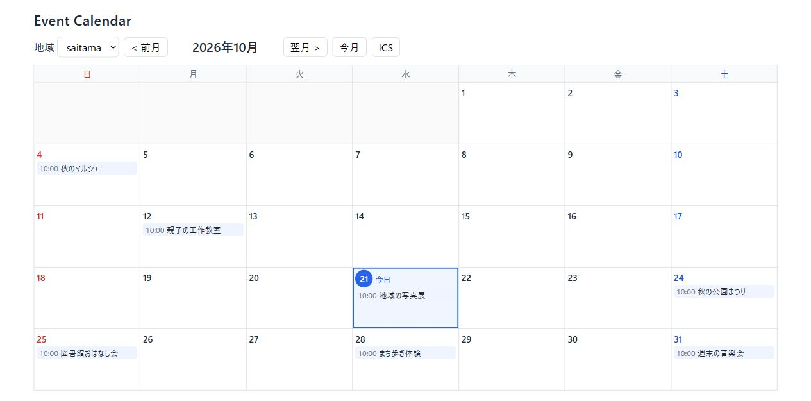
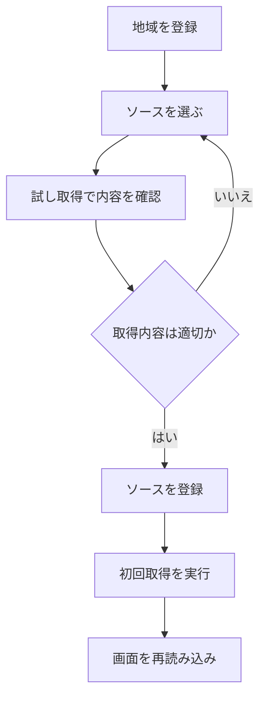
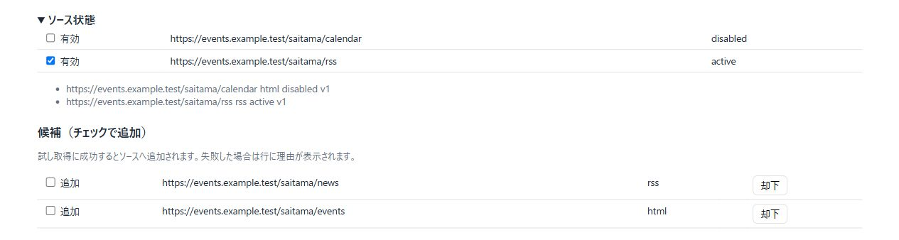
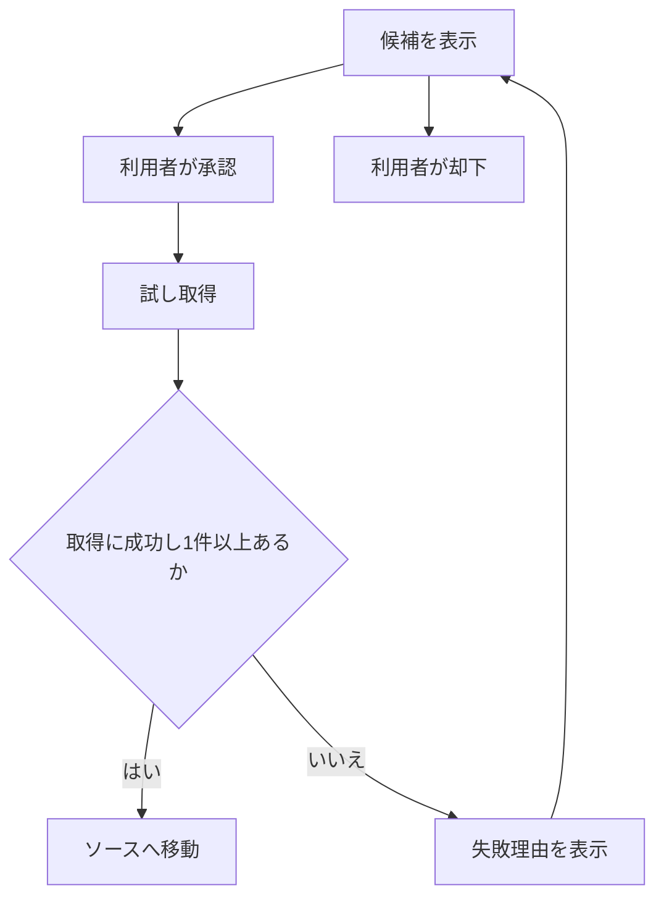
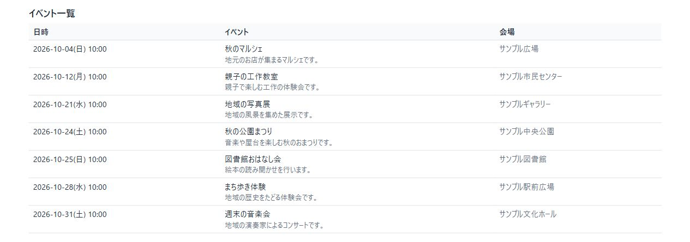

# event-calendar

地域のイベントを集めるカレンダーです。
登録した収集先から、イベントを定期取得します。
ブラウザーで予定を確認できます。
ICSファイルを他のカレンダーに取り込めます。

- 対応する収集先は、iCalendar・RSS・JSON-LD・HTML・JSON APIです。
- 検索機能は、収集先の候補を探します。
- 利用者が候補を承認すると、定期収集を始めます。
- ソフトウェアのライセンスは[MIT](LICENSE)です。



表示例は、2026年10月のカレンダーです。
以下の画像にある予定・会場・URLは、サンプルです。

## はじめに動かす

Node.js 24とnpmを用意してください。
以下は、プロジェクトルートから始める手順です。
コマンド例はPowerShell 7用です。

```powershell
cd src
npm install
node src/daemon.ts --port 18787
```

起動後に[カレンダー画面](http://127.0.0.1:18787/)を開きます。
停止するときは、起動した端末でCtrl+Cを押します。
初回は、地域と収集先の登録が必要です。

デーモンは、画面とAPIを提供する常駐処理です。
デーモンは、定期収集も実行します。
データは、既定で`src/.event-calendar/event-calendar.db`に保存します。

> 以下のコマンドは、すべて`src`内で実行します。
> 操作用に、別のPowerShellを開いてください。
> その端末も、プロジェクトルートから`cd src`で移動します。

## 対象地域を追加する

### 1. 地域を登録する

地域の登録にはCLIを使います。
次の例は、埼玉県を登録します。

```powershell
node bin/ec.ts region add --id saitama --name '埼玉県' --tz Asia/Tokyo --keywords '["埼玉県","さいたま市"]'
```

| 引数 | 指定する内容 |
|---|---|
| `--id` | 地域の識別子。例：`saitama` |
| `--name` | 地域名。例：`埼玉県` |
| `--tz` | タイムゾーン。日本は`Asia/Tokyo` |
| `--keywords` | 地域判定に使う語のJSON配列 |

この4項目は必須です。
同じ`id`で登録すると、既存の地域を更新します。
中心座標と半径は、必要な場合に指定します。
例：`--center '{"lat":35.86,"lon":139.65}' --radius-km 20`。

### 2. 収集先を登録する

収集先のURLと取得方法の組を「ソース」と呼びます。
地域を登録しただけでは、イベントは集まりません。
ソースを同じ地域IDに結び付けます。

URLが分かる場合は、まず試し取得を行います。
次の例は、埼玉新聞のニュースRSSを使います。
URLの提供状況と利用条件は、登録前に確認してください。

```powershell
$sourceUrl = 'https://news.yahoo.co.jp/rss/media/saitama/all.xml'
$spec = '{"kind":"rss","date_from":"content","include_keywords":["開催","実施","催し","イベント","フェスティバル","まつり","祭り","展示","公演","コンサート","参加者を募集","入場無料"],"region_policy":{"mode":"trust_source"}}'
node bin/ec.ts source test --url $sourceUrl --spec $spec
```

試し取得は、イベントを保存しません。
結果のタイトルと開催日を確認してください。
内容と利用条件を確認できたら、登録します。
`--terms-note`には、確認した内容を記録します。

```powershell
$added = node bin/ec.ts source add --url $sourceUrl --region-id saitama --terms-note '利用条件と取得結果を確認済み' --allow-redistribute false --spec $spec | ConvertFrom-Json
$added
```

登録処理も、ソースを試し取得します。
取得件数が0件の場合、通常は登録しません。
`--allow-redistribute false`は、ICSの情報を制限します。
ICSには、日時・タイトル・URLを出力します。
説明と会場情報は、出力しません。
説明と会場情報も出力する場合は、利用条件を確認します。
そのうえで、登録時に`true`を指定します。

### 3. 取得して画面を確認する

登録に成功したら、初回の取得を実行します。

```powershell
node bin/ec.ts run --id $added.source.id
node bin/ec.ts source list --region-id saitama
```

カレンダー画面を再読み込みします。
地域欄から`saitama`を選択します。
画面の地域欄は、登録済みソースの地域IDを表示します。
地域だけを登録した段階では、選択肢に出ません。
以後は、デーモンがソースを定期取得します。
取得間隔の既定値は、6時間です。



### URLが分からない場合

検索設定を有効にすると、ソースの候補を探せます。
設定方法は、後述の「検索と取得の設定」を参照してください。
手動で探索する場合は、次を実行します。

```powershell
node bin/ec.ts source discover --id saitama --limit 10
```

画面の「ソース状態」を開きます。
「候補」のチェックボックスで、候補を承認します。
承認処理は、候補を試し取得します。
取得件数が0件の場合、ソースに追加しません。
失敗時は、行に理由を表示します。
利用者は、同じ行から再試行できます。
不要な候補は、「却下」で除外します。
robots.txtで取得を禁止した候補は、選択できません。

画面から承認したソースは、再配布を許可しない設定です。
ICSには、日時・タイトル・URLを出力します。
説明と会場情報は、出力しません。
画面は、確認メモに`GUIで承認`を保存します。
再配布を許可して登録する場合は、前述のCLIを使います。





## カレンダー画面を使う

- 地域欄で、表示する地域IDを選びます。
- 「前月」「次月」で、表示する月を変えます。
- 「今月」で、現在の月に戻ります。
- カレンダーは、今日の日付を強調します。
- イベントのリンクから、元の掲載ページを開けます。
- 「ソース状態」の「有効」で、定期収集を切り替えます。

無効にしたソースの状態は、`disabled`になります。
取得済みのイベントは残ります。
設定の`week_start`で、週の開始曜日を変えられます。
`sunday`は日曜始まり、`monday`は月曜始まりです。

候補の承認に成功すると、候補がソース一覧へ移ります。
通信エラー時は、保存が済んでいる場合もあります。
画面を再読み込みして、保存状態を確認します。

イベント一覧は、日時・内容・会場を表示します。



### 他のカレンダーへ取り込む

「ICS」ボタンは、表示中の月をファイルに保存します。
その後、Googleカレンダーのインポート画面を開きます。
保存したICSファイルを、その画面で読み込んでください。
再配布を許可しないソースも、基本情報を出力します。
その場合は、説明と会場情報を省きます。

CLIで出力する場合は、次を実行します。

```powershell
node bin/ec.ts export --region-id saitama --from 2026-10-01T00:00:00+09:00 --to 2026-11-01T00:00:00+09:00 | Set-Content -Encoding utf8 saitama.ics
```

## 検索と取得の設定

設定ファイルは、`src`内に置きます。
初回は、サンプルをコピーして編集します。
既に`config.json`がある場合は、そのファイルを使います。

```powershell
Copy-Item config.sample.json config.json
```

`config.json`は、Gitの管理対象外です。
APIキーも、このファイルに記録します。
次は、検索と月曜始まりを有効にする例です。

```json
{
  "week_start": "monday",
  "search_providers": ["duckduckgo"],
  "x_search": true,
  "jina_fallback": false
}
```

設定を読み込むには、デーモンを再起動します。

```powershell
node src/daemon.ts --port 18787 --config config.json
```

サンプルは、Brave・DuckDuckGo・X投稿の探索を設定します。
サンプルは、jinaによる再取得も有効にします。
組み込みの既定設定では、これらは無効です。

### ソース候補を探す

| 検索先 | 設定 | 動作 |
|---|---|---|
| Brave Search API | `search_providers`に`brave`を追加 | `brave_api_key`が必要。未設定なら省略 |
| DuckDuckGo | `search_providers`に`duckduckgo`を追加 | `html.duckduckgo.com`を使用 |
| Yahoo! リアルタイム検索 | `x_search: true` | 地域ごとにX投稿の候補を1件作成 |

デーモンは、地域ごとに候補を定期探索します。
探索間隔の既定値は、1日です。
登録済みURLと却下済み候補は、再提案しません。
最終探索時刻は、DBの`discover_run`に保存します。
再起動だけでは、直前の探索を繰り返しません。
候補は、承認後に定期収集の対象になります。

DuckDuckGoのボット確認が出た場合は、6時間休止します。
システムは、ボット確認を突破しません。
Bingは、robots.txtの制限により非対応です。

X投稿の候補は、`kind: html`を使います。
パーサーは、`yahoo_realtime`です。
`date_from: content`が、本文の日付を開催日に使います。
日付のない投稿は、取り込みません。
一覧から消えた投稿も、取消にはしません。

### HTMLを取得する

システムは、一部の掲載サイトに抽出設定を補います。
設定を明示した場合は、その設定を優先します。
取得に成功すると、抽出設定をソースに保存します。

- ちょこたび埼玉の`/event/`には、カード用CSSを使います。
- 埼玉県の`/cgi-bin/event_cal/cal_month.cgi`には、専用設定を使います。

埼玉県のカレンダーは、ページの年月を参照します。
各イベントの日付は、カレンダーのセルから読み取ります。
同じURLでも開催日が違う場合は、別の項目にします。
背景のreCAPTCHAスクリプトだけでは、取得を拒否しません。
ログイン画面や実際の認証要求は、取得を拒否します。

`jina_fallback: true`は、外部サービスで再取得します。
対象は、HTMLとJSON-LDのソースです。
再取得は、次の場合に限ります。

- 通信エラー、またはHTTP 5xxが発生した場合。
- 取得結果が0件だった場合。

robots.txtによる禁止時は、再取得しません。
ログイン要求やCAPTCHA時も、再取得しません。
HTTP 4xx・429時も、再取得しません。
再取得先は、既定で`https://r.jina.ai/`です。
システムは、対象URLをこのサービスに送信します。
取得時のヘッダーは、`X-Return-Format: html`です。

### 記事から開催日を読む

RSSの`pubDate`は、記事の公開日です。
`date_from`の既定値は、`published`です。
この設定では、公開日をイベントの日付に使います。
ニュースRSSでは、前述の例の`content`を使えます。

`date_from: content`は、記事内の開催日を探します。
探索順は、タイトル、概要、本文です。
RSS本文は、`content:encoded`を参照します。
最初に見つかった和文日付を採用します。
開催日が見つからない記事は、取り込みません。
除外件数は、警告に表示します。

- 西暦の例：`2026年11月14日`。
- 和暦の例：`令和8年11月14日(土)`。
- 年なしの例：`10月18日開催`、`11月14日 10:30`。
- 期間の例：`10月18日〜19日`。

年なしの日付は、公開日を基準に年を推定します。
月日がない場合は、月なし表記も調べます。
`24、25日は`や`18日午前5時半`が対象です。
年月は、日本時間の公開日を使います。
`D、D+1日`は、2日間の範囲にします。
`3日間`・`1日現在`・`7日以内`は、日付にしません。

`include_keywords`で、記事を絞り込めます。
タイトル・概要・本文のいずれかを調べます。
指定語を1つ以上含む記事だけを採用します。
除外件数は、警告に表示します。
日付の抽出結果は、登録前に確認してください。

既存ソースの取得方法は、CLIで更新します。
`source list`で、ソースIDと`spec_version`を確認します。
次の値は、実際のソースに合わせて置き換えます。

```powershell
$sourceId = 'ソースID'
$version = 1
node bin/ec.ts source update --id $sourceId --expected-version $version --spec $spec
```

`$spec`は、前述のRSS例と同じ変数です。
更新時は、試し取得を行います。
取得方法の更新は、HTTPの条件付き取得情報もリセットします。
更新後は、ETagによる304応答だけで処理を終えません。

## 常駐起動とデータ保存

Windows用の起動スクリプトを用意しています。
事前に、`src/config.json`を作成してください。

```powershell
powershell -NoProfile -ExecutionPolicy Bypass -WindowStyle Hidden -File scripts\run-daemon.ps1
```

スクリプトは、`config.json`を使って起動します。
データの保存先は、`.event-calendar`です。
ログは、`.event-calendar/daemon.log`へUTF-8で追記します。
デーモンが終了すると、10秒後に再起動します。
ログオン時の起動には、タスクスケジューラを使えます。
停止時は、先にスケジューラのタスクを終了します。
次に、残ったデーモンのNodeプロセスを終了します。
片方だけを停止すると、常駐処理が残る場合があります。

### 起動オプション

```text
node src/daemon.ts [--port N] [--db PATH] [--data-dir DIR] [--host H] [--config FILE] [--stdin-shutdown]
```

- 既定の接続先は、`127.0.0.1:18787`です。
- `--port 0`は、空きポートを選びます。
- `--db`は、DBファイルの保存先を変えます。
- `--data-dir`は、データ用ディレクトリを変えます。
- `--host`は、待受ホストを変えます。

起動成功時は、標準出力に次の形式を1行出します。

```json
{"event":"listening","port":18787}
```

通常は、SIGINTまたはSIGTERMで停止します。
WindowsのSIGTERMでは、正常終了できない場合があります。
`--stdin-shutdown`は、標準入力でも停止を受け付けます。
`shutdown`を含む行、または入力の終了で停止します。
この指定は、`node src/daemon.ts`と`ecd`で使えます。
`ec daemon`では使えません。
常駐スクリプトには、標準入力がありません。
そのため、`--stdin-shutdown`を付けません。

## CLIリファレンス

`node bin/ec.ts <コマンド>`で操作します。
`ec`として登録した環境では、`ec <コマンド>`も使えます。
`region_upsert`と`region add`は、同じ操作です。
アンダースコアは、空白でも指定できます。

| コマンド | 操作 |
|---|---|
| `region_upsert` / `region add` / `region set` | 地域を登録・更新 |
| `source_discover` | 地域のソース候補を探索 |
| `source_test` | ソースを試し取得 |
| `source_add` | ソースを登録 |
| `source_list` | ソースを一覧表示 |
| `source_update` | ソースを更新 |
| `source_remove` / `source rm` / `source delete` | ソースを削除 |
| `run_now` / `run` | ソースを即時取得 |
| `source_approve` | 候補を承認 |
| `approval_issue` / `approval issue` | 操作用の承認トークンを発行 |
| `events_search` / `events` | イベントを検索 |
| `calendar_export` / `export` | ICSを出力 |
| `health` | 稼働状態を確認 |
| `daemon` | デーモンを起動 |

引数は、`--key value`か`--key=value`で指定します。
引数名のハイフンは、アンダースコアに変換します。
`id`と末尾が`_id`の値は、常に文字列です。
残りの位置引数が1つの場合は、`id`として扱います。

| 共通オプション | 用途 |
|---|---|
| `--base-url URL` | 接続するデーモンを変更 |
| `--embedded` | デーモンを使わず、DBを直接操作 |
| `--data-dir DIR` | embeddedモードのデータ保存先を変更 |
| `--db PATH` | embeddedモードのDBファイルを変更 |
| `--config FILE` | embeddedモードの設定ファイルを指定 |
| `--help` | コマンド名なしで、使い方を表示 |

通常のCLIは、デーモンのHTTP APIに接続します。
embeddedモードは、バックグラウンド処理を起動しません。
通常のCLIで`--config`だけを指定すると、エラーになります。
デーモン起動時の`--config`は、そのまま使えます。

引数なしの場合は、使い方を標準エラー出力に表示します。
終了コードは、2です。
コマンド名なしの`--help`は、終了コード0です。
コマンド名に続く`--help`は、通常の操作を実行します。

### エラーを確認する

| 終了コード | 意味 |
|---|---|
| 0 | 成功 |
| 2 | 引数・設定が不正：`INVALID_ARGUMENT` |
| 3 | 試し取得が0件：`ZERO_ITEMS` |
| 4 | デーモンへ接続できない：`DAEMON_UNAVAILABLE` |
| 1 | その他のエラー |

CLIは、エラーを標準出力にJSONで返します。
形式は、`{"error":{"code":"…","message":"…","details":{}}}`です。
接続エラー時は、デーモンの起動状態を確認します。
単発操作では、`--embedded`も使えます。

## HTTP APIリファレンス

接続先の既定値は、`http://127.0.0.1:18787`です。
リクエスト本文は、最大1MiBのJSONです。

| メソッド | パス | 用途・主な条件 |
|---|---|---|
| PUT | `/regions/{id}` | 地域を登録・更新 |
| POST | `/regions/{id}/discover` | 候補を探索 |
| POST | `/sources:test` | 試し取得 |
| POST | `/sources` | ソースを登録 |
| GET | `/sources` | `region_id`・`state`で絞り込み |
| PATCH | `/sources/{id}` | ソースを更新。`expected_version`が必須 |
| DELETE | `/sources/{id}` | `dry_run`・`approval_token`は本文かクエリーで指定 |
| POST | `/sources/{id}/run` | 即時取得 |
| POST | `/candidates/{id}/approve` | 候補を承認 |
| GET | `/candidates` | `region_id`・`status`で絞り込み。既定は`proposed` |
| POST | `/candidates/{id}/reject` | 候補を却下 |
| POST | `/approvals` | 操作用の承認トークンを発行 |
| GET | `/events` | `region_id`・`from`・`to`が必須。`q`・`source`でも絞り込み |
| GET | `/calendar/{region_id}.ics` | ICSを取得。`from`・`to`で期間を指定 |
| GET | `/health` | 稼働状態を確認 |

`GET /`は、カレンダー画面を返します。
`GET /gui/*`は、`gui/`内の静的ファイルを返します。
パストラバーサルは、`INVALID_ARGUMENT`です。
上記以外のルートはありません。

### ICSの取得条件

内部のルート名は、`/calendar/{file}`です。
ファイル名の末尾が`.ics`の場合だけ有効です。
拡張子を除いた部分を、地域IDとして使います。
例：`/calendar/saitama.ics`。
`.ics`以外は、`NOT_FOUND`を返します。

期間は、ISO日時の`from`・`to`で指定します。
日時の不正や`from > to`は、`INVALID_ARGUMENT`です。
省略時の期間は、現在の90日前から365日後です。
Content-Typeは、`text/calendar; charset=utf-8`です。
応答には、`ETag`が付きます。
`If-None-Match`の一致時は、304を返します。
`If-None-Match: *`も受け付けます。

### GUIトークン

GUIトークンは、起動ごとに生成する64桁の16進数です。
システムは、トークンをディスクに保存しません。
`GET /`は、HTMLの`meta[name="gui-token"]`に埋め込みます。
画面は、APIへ`X-GUI-Token`を付けます。
値が違う場合は、`INVALID_ARGUMENT`を返します。
ヘッダーのないCLIリクエストは、検査しません。

GETの`/`・`/gui/*`・ICS取得は、検査対象外です。
コード上は、`/static/*`と`/assets/*`も対象外です。
ただし、これらを配信するルートはありません。
週の開始曜日は、HTMLの`meta[name="week-start"]`で渡します。

### HTTPエラー

| 状態コード | エラー |
|---|---|
| 400 | `INVALID_ARGUMENT` |
| 403 | `SSRF_BLOCKED`・`ROBOTS_DISALLOWED`・`APPROVAL_REQUIRED` |
| 404 | `NOT_FOUND` |
| 409 | `CONFLICT` |
| 422 | `ZERO_ITEMS` |
| 502 | `FETCH_FAILED` |
| 500 | 想定外の内部例外。コードは`FETCH_FAILED` |

## 設定リファレンス

設定値の正本は、[src/src/config.ts](src/src/config.ts)です。
`--config`は、JSONオブジェクトを読み込みます。
未知のキーや不正な値は、`INVALID_ARGUMENT`です。
読めないファイルや不正なJSONも、同じエラーです。
CLIの終了コードは、2です。
デーモンは、不正な設定では起動せず、1で終了します。

`ssrf_allowlist`は、ホスト名かIPで指定します。
スキーム・ポート・パスは、指定できません。
環境変数で設定を上書きする仕組みはありません。
設定の上書きは、浅いマージです。
`host_rate`と`retry_backoff`だけは、1階層マージします。

| キー | 既定値 |
|---|---|
| interval_sec | 21600 |
| interval_min | 900 |
| tick | 60 |
| job_timeout | 120 |
| lease | 600 |
| connect_timeout | 10 |
| total_timeout | 30 |
| body_max | 5242880 |
| global_concurrency | 4 |
| redirect_max | 5 |
| max_pages | 5 |
| max_pages_limit | 20 |
| search_providers | [] |
| brave_api_key | "" |
| x_search | false |
| x_search_base | https://search.yahoo.co.jp/realtime/search |
| discover_interval_sec | 86400 |
| discover_limit | 10 |
| jina_fallback | false |
| jina_base | https://r.jina.ai/ |
| degraded_after | 3 |
| quarantine_after | 10 |
| drift_ratio | 0.8 |
| drift_min_prev | 5 |
| disappear_runs | 3 |
| cancelled_retention | 30 |
| recurrence_horizon | 90 |
| year_past_window | 30 |
| year_future_window | 183 |
| interval_jitter | 0.1 |
| dedup_time_window | 60 |
| dedup_jaccard | 0.8 |
| keyword_full_hits | 2 |
| min_confidence | 0.5 |
| trust | 0.5 |
| listen | `127.0.0.1:18787` |
| busy_timeout | 5000 |
| search_provider | `none` |
| geocoder | `none` |
| redact_contact | true |
| ssrf_allowlist | `[]` |
| contact_url | `http://127.0.0.1:18787/about` |
| host_rate | `{requests: 1, per_sec: 5}` |
| retry_backoff | `{base_sec: 60, cap_sec: 600, jitter: 0.2, max_attempts: 5}` |
| failure_stretch_cap_sec | 86400 |
| robots_cache | 86400 |
| require_approval | `["source_remove", "enable_browser"]` |
| approval_token_ttl | 600 |
| week_start | `"sunday"`(GUI カレンダーの週の開始曜日。`"monday"` で月曜始まり) |
| holiday_url | `"https://holidays-jp.github.io/api/v1/date.json"`(日本の祝日データの取得先) |
| holiday_interval_sec | 604800(祝日データの自動更新間隔。0 で更新しない) |

## 開発と検査

実装は、`src`にあります。
実行時は、Node.jsのTypeScript型ストリップを使います。
DBは、`node:sqlite`です。
テストは、`node:test`です。
実行時依存は、ajv・cheerio・ical.jsです。
依存の取得には、ネットワーク接続が必要です。

```powershell
npm test
npm run check
```

- `npm test`は、`test/**/*.test.ts`を実行します。
- `npm run check`は、型検査・lint・モジュール読込検査を実行します。
- `npm run typecheck`は、`tsc --noEmit`を実行します。
- `npm run lint`は、`eslint .`を実行します。
- 読込検査だけなら、`node --test test/acceptance/modules-load.test.ts`を使います。

Node.js 24では、`node --test test/`は失敗します。
glob指定は、一致が0件でも成功する場合があります。
読込検査は、対象件数が0件の場合も検出します。
読込検査は、構文解析とimportの解決を確認します。
読込時の評価で発生するエラーも検出します。
デーモンは、読み込むだけで起動するため対象外です。
デーモンの起動は、受入テストで確認します。

型検査は、`bin`・`src`・`test`を対象にします。
設定は、`noEmit`と`strict`を有効にします。
未使用ローカル変数とswitchのfallthroughを検出します。
`erasableSyntaxOnly`と`verbatimModuleSyntax`も有効です。
GUIのJavaScriptは、型検査を行いません。
`typescript-eslint`との互換性のため、TypeScriptは6系です。

lintは、ESLint 10のflat configを使います。
基本ルールは、`@eslint/js`と`typescript-eslint`です。
`node_modules`は、検査対象外です。
`bin`・`src`・`test`は、Nodeのグローバル変数を使います。
`gui/*.js`は、ブラウザーのグローバル変数を使います。
未使用名の先頭が`_`の場合は、警告を除外します。
分割代入の残余要素と同時に取り出した項目も除外します。
`test/**`だけは、明示的な`any`を許可します。

### 関連資料

- [設計書](docs/design-event-calendar.md)
- [仕様書と用語集](docs/specification.md)
- [実装計画](docs/plans/plan-event-calendar.json)

## 対応範囲

チケット購入とログイン必須サイトは、対象外です。
SNSの非公開投稿も、収集しません。
多ユーザー化とイベント推薦は、対象外です。
MCPサーバーは、提供しません。

## ライセンス

このソフトウェアは、MIT Licenseで提供します。
全文は、[LICENSE](LICENSE)を参照してください。
収集先のコンテンツには、各提供元の利用条件が適用されます。
