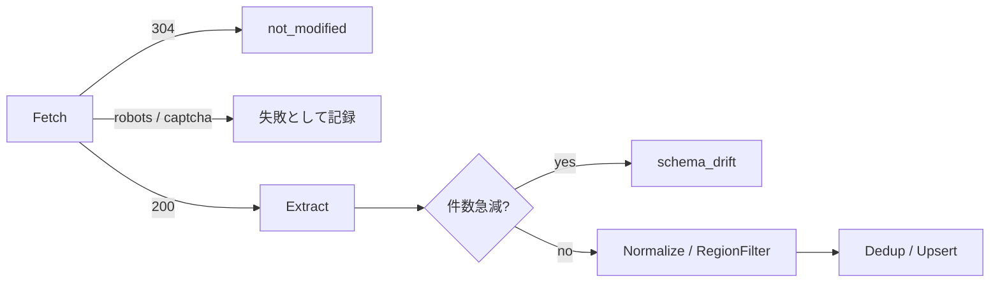
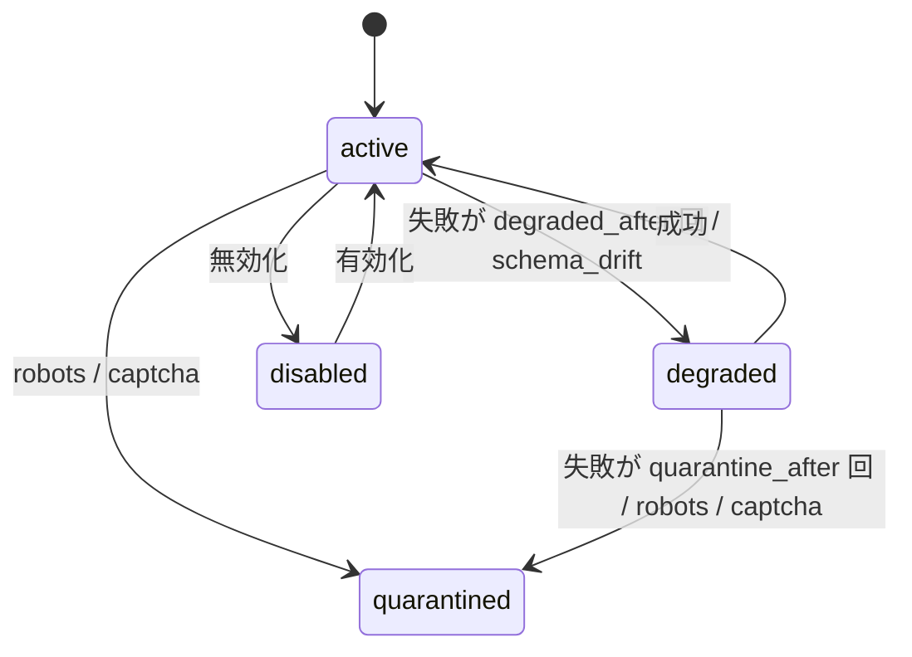

<!-- spec-doc:last-reviewed-commit=06704d8edcbc19589286322c341924123f2d524d reviewed-at=2026-10-17 -->

# 仕様書

<!--
このファイルは /spec-doc コマンドが git 差分から自動で追記・更新する。
- 先頭のマーカー行は /spec-doc が「前回どのコミットまで確認したか」を記録するためのもの。
  手で編集しない（初回はマーカーなしのままでもよく、その場合 /spec-doc が初回モードで動く）
- 構成: 対象（機能 / モジュール / API / 設定 など）ごとに節を分ける
- 実装手順ではなく「何が・どう振る舞うか」（仕様・挙動・設計意図）を書く
-->

## 1. 概要

- 対象は地域イベントカレンダー(event-calendar)。実装は `src/claude/` にある。
- システムは登録したソースからイベントを定期収集する。
- 収集したイベントは地域ごとに検索でき、ICS でも配信する。
- 実行環境は Node v24 の型ストリップ、`node:sqlite`、`node:test`。
- 設計の正本は `docs/design-event-calendar.md` とする。
- `docs/design-event-calendar.orig.md` はポート変更前の設計書の写し。
- 操作の詳細(全コマンド・全既定値)は `src/claude/README.md` に書く。

## 2. 構成

- デーモンが HTTP API・GUI 配信・定期実行ワーカーを持つ。
- CLI(`ec`)は既定でデーモンの HTTP API を呼ぶ。
- CLI は `--embedded` でデーモン無しに DB を直接操作する。
- `--embedded` はバックグラウンドワーカーを起動しない。
- データは 1 つの SQLite ファイルに置く。既定は `<data-dir>/event-calendar.db`。
- data-dir の既定は `.event-calendar`。このディレクトリは git 管理外。

## 3. 設定

- 設定は既定値に JSON の上書きを浅くマージしたものになる。
- `host_rate` と `retry_backoff` だけは 1 階層マージする。
- 設定ファイルは `--config <file>` で渡す。
- デーモン(`node src/daemon.ts` / `ecd` / `ec daemon`)は `--config` を受け付ける。
- CLI は `--embedded` と併用したときだけ `--config` を受け付ける。
- CLI で `--embedded` 無しに `--config` を使うと INVALID_ARGUMENT(exit 2)になる。
- 次の場合、設定ファイルは INVALID_ARGUMENT で拒否される。
  - ファイルを読めない。
  - JSON として不正、またはオブジェクトでない。
  - 未知のキーを含む。
  - `ssrf_allowlist` にホスト名/IP 以外(スキーム・ポート・パス付き)を含む。
  - `week_start` が `sunday` / `monday` 以外。
- デーモンは不正な設定ファイルを受けると起動せず exit 1 で終わる。
- 環境変数で設定を変える手段は無い。SSRF 許可リストも設定ファイルでだけ変える。

### 3.1 主な既定値

| キー | 既定値 | 意味 |
|---|---|---|
| `listen` | `127.0.0.1:18787` | デーモンの待受。8787 は他用途と衝突するため 18787 |
| `contact_url` | `http://127.0.0.1:18787/about` | User-Agent に書く連絡先 |
| `week_start` | `sunday` | GUI カレンダーの週の開始曜日。`monday` で月曜始まり |
| `ssrf_allowlist` | `[]` | プライベートアドレスへの取得を許すホスト |
| `search_provider` | `none` | ソース自動探索の検索手段。`none` では探索不可 |
| `year_past_window` / `year_future_window` | 30 / 183 | 年なし日付の年推定の窓(日) |
| `disappear_runs` | 3 | 何回連続で見えなければ取消にするか |

## 4. 地域とソース

- 地域は `id`・`name`・`tz`・`keywords` を持つ。中心座標と半径は任意。
- ソースは 1 つの地域に属し、URL と SourceSpec を持つ。
- ソース登録時、システムは試し取得(dry run)を行う。0 件ならソースを登録しない。
- ソース登録には `terms_note` と `allow_redistribute` が必須。
- ソース更新は楽観ロックで行う。`expected_version` が現在の `spec_version` と違えば CONFLICT になる。
- 更新が成功すると `spec_version` が 1 増え、旧 spec は履歴に残る。
- ロールバックは履歴の spec を新しい版として復元する。
- spec を更新またはロールバックすると、ETag と Last-Modified が消える。
- そのため次回の取得は 304 にならず、新しい spec で再抽出する。
- ソース削除とブラウザ描画の有効化は、単回使用の承認トークンを要する。

### 4.1 SourceSpec

- `kind` は `ical` / `rss` / `jsonld` / `html` / `json_api` のいずれか。
- `region_policy.mode` は `trust_source` / `keyword` / `geo` のいずれか。
- `kind=html` のとき `extract`(`item_selector` と `fields`)が必須。
- `fields` は `title` と `date` が必須。各フィールドは CSS セレクタと任意の属性名を持つ。
- `fetch.paging` は「次へ」リンクのセレクタで複数ページを辿る。
- `date_from` は開催日の取り方を決める(4.2 節)。既定は `published`。
- SourceSpec は最上位でだけ未知のキーを拒否する(要確認: 入れ子の未知キーは通る)。

### 4.2 開催日の決定(`date_from`)

- ニュース系 RSS の pubDate は記事の公開日であり、開催日と違う場合がある。
- `date_from: published` のとき、システムはフィード/ページの日付をそのまま開始日時にする。
- `date_from: content` のとき、システムは記事中の日付を開催日にする。
- 探す順はタイトル → 概要 → 本文(RSS の `content:encoded` を HTML 除去したもの)。
- 最初に見つかった日付を採用する。
- 認識する表記は次のとおり。
  - `令和N年M月D日`、`YYYY年M月D日`、年なしの `M月D日`(全角数字可)。
  - 直後の曜日 `(土)`。
  - 時刻 `10:30`、`14時`、`午後2時`。時刻があれば終日ではない。
  - 範囲 `〜D日`、`〜M月D日`。範囲の終わりが終了日になる。
- 年なしの日付は公開日を基準に年を推定する。公開日が無ければ現在時刻を使う。
- 推定した日付が `year_future_window` より先なら、イベントは `tentative` になる。
- 日付が見つからない記事は取り込まない。件数は warning に出る。
- 本文は日付の検索にだけ使い、DB には保存しない。

## 5. 取り込みパイプライン

- 1 回の実行は Fetch → Extract → Normalize → RegionFilter → Dedup/Upsert の固定順で進む。
- Fetch は robots.txt・SSRF 防御・ホスト単位レート制限・条件付き GET を適用する。
- Extract の優先順は iCal → JSON-LD → RSS/Atom → CSS → LLM。
- 最初に 1 件以上を返した抽出器の結果を使う。
- LLM 抽出は `llm_fallback: true` で、他が 0 件のときだけ動く。
- Normalize は日付を UTC に変換し、テキストを無害化する。
- 前回件数に比べて件数が急減すると、実行は `schema_drift` になり取り込まない。

### 5.1 日付の解釈

- ISO 形式の日付・日時を受け付ける。オフセットの無い値はソースの tz で解釈する。
- RFC 822 形式(RSS の pubDate)は、末尾にタイムゾーンがある場合だけ受け付ける。
- 和文の `2026年12月13日(日)` も受け付ける。時刻付きと範囲(先頭の日付を採用)も受け付ける。
- 時刻の無い日付は終日イベントになる。
- 解釈できない日付のアイテムは捨てる。

### 5.2 イベントの消失

- 成功した実行で見えたアイテムは `miss_count` が 0 に戻る。見えなかったアイテムは 1 増える。
- 未来のイベントは、全参照の `miss_count` が `disappear_runs` 以上になると `cancelled` になる。

## 6. ソースの状態

- ソースの状態は `active` / `degraded` / `quarantined` / `disabled` のいずれか。
- `blocked_robots` と `login_or_captcha` は即座に `quarantined` にする。
- `failed` / `rate_limited` / `schema_drift` は連続失敗数を 1 増やす。
- 連続失敗数が `degraded_after`(3)以上で `degraded`、`quarantine_after`(10)以上で `quarantined` になる。
- `schema_drift` は 1 回で `degraded` になる。
- 成功(`ok` / `not_modified` / `partial`)は連続失敗数を 0 に戻し、`degraded` を `active` に戻す。
- ただし 0 件の連続が 3 回以上なら `degraded` のまま残る。
- `quarantined` と `disabled` は自動では戻らない。

- CAPTCHA 判定は、本文に `captcha` 等の文字列があるだけで成立する(要確認: 問い合わせフォームに reCAPTCHA を置いた通常ページも弾く)。

## 7. HTTP API と認証

- デーモンは 13 の API ルートと静的配信(`GET /`、`GET /gui/*`)を持つ。
- `GET /events` は `region_id`・`from`・`to` が必須。無いと INVALID_ARGUMENT(400)になる。
- `GET /calendar/{region_id}.ics` は ICS を返す。ETag と `If-None-Match` で 304 を返す。
- `X-GUI-Token` ヘッダ付きのリクエストだけトークンを検証する。値が違うと 400 になる。
- ヘッダの無いリクエスト(CLI)は検証しない。
- トークンは起動ごとに生成し、ディスクに書かない。
- `GET /` が返す `index.html` には次の 2 つが埋め込まれる。
  - `<meta name="gui-token">`: そのときのトークン。
  - `<meta name="week-start">`: 設定 `week_start`。`monday` 以外の値は `sunday` として埋め込む。

## 8. CLI

- コマンド名は API 操作名と同じ。`_` は空白で書ける(`source add` = `source_add`)。
- `--key value` は入力フィールドになる。`id` と `*_id` は常に文字列として渡す。
- JSON 形式の値(`[...]`、`{...}`)は JSON として解釈する。
- 終了コードは 0 成功 / 2 INVALID_ARGUMENT / 3 ZERO_ITEMS / 4 デーモン未起動 / 1 その他。

## 9. デーモン

- デーモンは起動後、stdout に `{"event":"listening","port":N}` を 1 行出す。
- ポートを指定しなければ設定 `listen` のポートを使う。`--port 0` は空きポートを使う。
- SIGINT / SIGTERM で停止する。
- Windows では `--stdin-shutdown` を付けると、stdin の `shutdown` 行または EOF で停止する。

## 10. GUI

- GUI は `http://127.0.0.1:18787/` で開く。外部 URL を参照しない。
- GUI は月表示のカレンダーとイベント一覧を出す。
- 地域の選択肢は、登録済みソースが属する地域から作る。
- 前月・翌月・今月のボタンで表示月を変える。
- GUI は表示月の前後 1 日を含む範囲で `GET /events` を呼ぶ。
- イベントは `start_local_date`(ソースの tz での日付)のマスに置く。
- マスには時刻(終日なら無し)とタイトルを出す。マウスを乗せると会場が出る。
- タイトルは元ページへのリンクになる。リンクにするのは `http` / `https` の URL だけ。
- 週の開始曜日は `<meta name="week-start">` に従う。
- 月初より前の空きマスは日付マスとして数えない。
- イベント一覧は日時・タイトル・概要・会場を時刻順に出す。
- ソースの状態は折りたたみ欄に URL・種類・状態・版で出す。

## 11. 既知の制限(要確認)

- 記事中の日付の採用は「最初に現れた日付」で決まる。そのため次の誤りが起こる。
  - 工事期間など、開催日でない日付を拾う。
  - 本文末尾の関連記事の見出しにある日付を拾う。
  - 店舗の開店日など、行事でない記事も日付があれば載る。
- 範囲表記のうち `M月D日からM月D日まで` は認識しない。
- CSS 抽出は、会場欄の見出しラベル(例「会場」)を値から除けない。
- RSS の概要に残る HTML 実体参照(`[&#8230;]` など)はそのまま表示される。
- `src/claude/README.md` 冒頭の起動例と CLI 表の `daemon` 行は `--config` を載せていない。

## 用語集

- **ソース**: 収集対象の URL と、その取り方(SourceSpec)の組。
- **SourceSpec**: ソースの種類・抽出方法・地域判定方針を定める JSON。
- **dry run**: 登録・更新の前に行う試し取得。取り込みはしない。
- **公開日**: フィードやページが示す記事の日付(RSS の pubDate など)。
- **開催日**: 記事が示すイベントの日付。`date_from: content` で使う。
- **embedded モード**: CLI がデーモンを介さず DB を直接操作する動作。
- **GUI トークン**: GUI のリクエストを他プロセスから区別するための、起動ごとの乱数。
